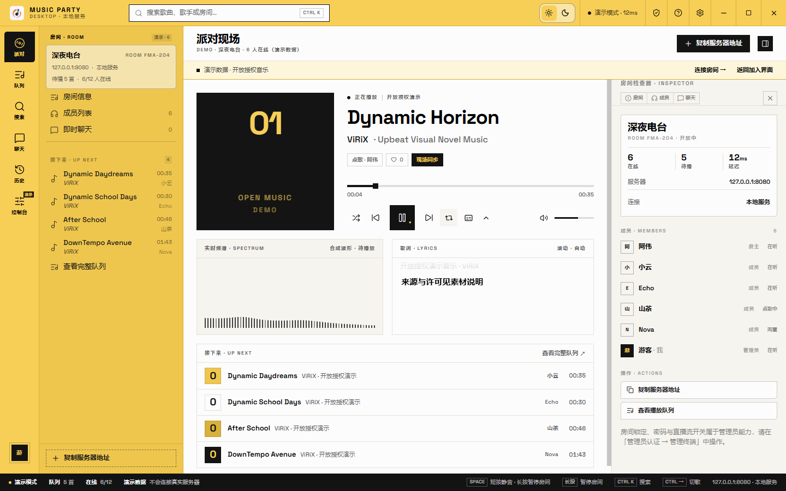

# MusicParty Desktop

MusicParty Desktop（MPD）是面向 Windows 的多人一起听歌桌面应用，将桌面客户端与本地服务集成为一个发行版本。与朋友进入房间后，可以一起管理播放队列、聊天和分享音乐，同时保留本机独立的音量与静音控制。

> 本项目**基于 [PluvIIter/MusicParty](https://github.com/PluvIIter/MusicParty) 开发**。感谢 MusicParty 原作者及贡献者提供的开源项目与付出！本项目为独立维护的桌面扩展，并非原项目官方发行版。

## 下载

前往 [Releases](https://github.com/Cuiside/MusicPartyDesktop/releases) 下载 Windows x64 版本。最新公开版本为 **0.9.4-beta.5**；0.9.7 发行附件仍在上传，功能介绍包含 0.9.7 的更新。

- **安装版（setup）**：运行安装程序，按提示选择安装位置。
- **便携版（portable）**：下载后直接运行，无需安装。
- **SHA256SUMS.txt**：用于校验下载文件的完整性。

发行包尚未进行代码签名，Windows 可能显示安全提示；请仅从本仓库发行页面下载并核对校验值。覆盖安装前建议备份个人配置，并退出正在运行的程序。

## 功能

- **多人房间与本地服务**：Windows 发行版集成客户端和本地服务；也可连接已有的 MusicParty 房间，与朋友共享播放队列。
- **多平台点歌**：
  - **网易云音乐**：支持搜索、公开歌单导入和专辑浏览；接口依赖 [NetEaseCloudMusicApiEnhanced](https://github.com/NeteaseCloudMusicApiEnhanced/api-enhanced)。
  - **Bilibili**：支持搜索和收藏夹导入；音频需要服务端缓存，可能消耗服务器带宽与流量。
  - **QQ 音乐**：支持搜索、歌单导入和专辑浏览；接口依赖 [QQMusicApi](https://github.com/L-1124/QQMusicApi)。
  - 音源入口取决于房间配置；账号权限、第三方服务及网络状态也会影响可用性。
- **同步播放与智能队列**：房间成员共享播放状态和待播队列；支持顺序、随机、轮询和单曲循环等模式，并可按房间权限排序、置顶和移除歌曲。
- **歌单与专辑**：可绑定平台用户查看公开歌单，浏览专辑并批量导入；重复歌曲由服务端跳过，客户端提示重复数量及仅供参考的曲目。
- **个性化桌面歌词**：歌词随播放展示，支持歌词动效、频谱、可调透明度的“柔光玻璃”背景，以及颜色、字体、字号和边框设置。
- **实时互动与全局提醒**：房间聊天、即时聊天和歌曲点赞，配合消息提醒与系统通知，让交流不打断听歌。
- **独立音量与静音**：本机调节音量或单击播放键静音，不影响其他成员；长按播放键可按房间权限暂停或恢复房间。
- **桌面体验**：提供多种主题颜色、深色模式、托盘和应用内用户帮助；管理员可通过控制台管理房间、音源及播放规则。

具体功能和音乐来源的可用性取决于服务配置、账号权限和第三方接口状态。

## 开始使用

1. 从 Releases 下载适合自己的安装版或便携版并启动。
2. 按应用内引导启动本地服务，或填写房间服务地址并连接。
3. 设置昵称并进入房间，搜索或选择歌曲加入队列。
4. 在设置中按需调整声音、外观和桌面歌词。

使用网易云等第三方服务时，可能需要自行配置账号凭证。请勿将 Cookie、密码、房间管理凭证等分享给他人，也不要提交到公开仓库。请只在信任的网络及房间中使用；将服务暴露到公网前，应自行检查访问控制、默认密码及网络安全配置。

## 问题反馈

欢迎通过 [Issues](https://github.com/Cuiside/MusicPartyDesktop/issues) 报告问题。请尽量说明版本号、Windows 版本、复现步骤、预期与实际结果，以及经过脱敏的截图或日志。提交前请移除账号凭证和其他隐私信息。

## 致谢与第三方许可

- **MusicParty**：感谢 [PluvIIter/MusicParty](https://github.com/PluvIIter/MusicParty) 的作者与贡献者。上游 README 声明使用 MIT License；本项目与上游项目保持各自维护。
- **NetEaseCloudMusicApiEnhanced**：项目及其贡献者提供的网易云音乐接口；相关许可见 [许可证](docs/NETEASE-API-LICENSE.txt) 和 [说明](docs/NETEASE-API-NOTICE.txt)。
- **QQMusicApi**：感谢 [L-1124/QQMusicApi](https://github.com/L-1124/QQMusicApi) 及其贡献者提供的 QQ 音乐接口。
- **演示音乐**：《Upbeat Visual Novel Music》，作者 ViRiX，来源 [OpenGameArt](https://opengameart.org/content/upbeat-visual-novel-music)，按 [CC BY 3.0](https://creativecommons.org/licenses/by/3.0/) 授权使用。曲目：Dynamic Horizon、Dynamic Daydreams、Dynamic School Days、After School、DownTempo Avenue；音频未作修改。

Electron、Java 运行时及其他第三方组件遵循各自的许可条款；其权利归各自权利人所有。

## 免责声明

本项目旨在补充 PC 端与朋友共同听歌的方式，仅供学习交流，不用于商业用途。本项目不提供音乐内容，也不提供绕过付费、版权或平台访问控制的功能。使用者应遵守适用法律及第三方平台条款，保护账号凭证，尊重版权并支持正版。第三方服务可能变更、中断或限制，本项目不代表任何音乐平台，也不保证第三方服务持续可用。
